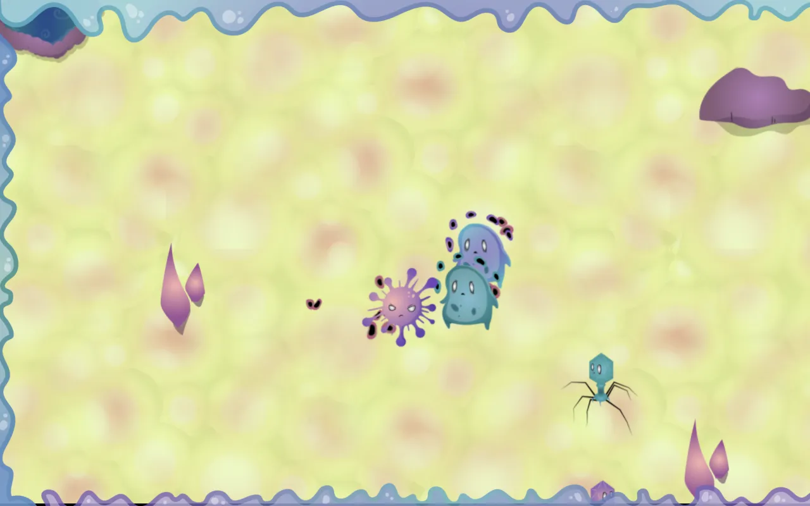

# Dirty little bits — Global Game Jam 2018

A microbe battle game made in 48 hours at Global Game Jam 2018 (theme: "Transmission"). Spawn and swap between units (collectors, tanks, missile units and kamikazes), grab power-ups, and fight the other team.

**[Play it in your browser](https://dirty-little-bits.projectz.co.nz)**



Made by David Neilsen, Daniel Larmour, Jason Grinter, Rey Benher, jakeb994 and Andrew Crossley.

## Controls

- **Space:** join on the title screen, then shoot.
- **Enter:** start the game.
- **Arrow keys:** move. **Tab:** switch unit.
- **Gamepads:** press A to join and Start to begin. Each controller is another player on the same screen.

## How it works

- `private/js/client/` is the browser game, drawn with PixiJS.
- `private/js/server/` is the game server. It runs the whole game and streams what's on screen to the browser over a WebSocket.
- `private/js/game-objects/` and `private/js/player-collections/` are the units, power-ups and teams the server simulates.

## Run it locally

The original Gulp 3 build doesn't run on current Node, so `dev/` has a small replacement:

```sh
./dev/start.sh
```

It builds the client into `public/`, starts the game server on port 8081, and serves the game at http://localhost:8080.

## Running on Cloudflare

The game server was a Node process using the `ws` package. Online, it runs on Cloudflare instead, with the game code unchanged:

- `cloudflare/worker.js` serves `public/` and gives each visitor their own Durable Object running the game server. The game resets the world whenever a screen connects, because it was built for one shared screen with gamepads.
- `cloudflare/ws-shim.js` stands in for the `ws` package, and `cloudflare/globals.js` for the few Node features the server uses.

